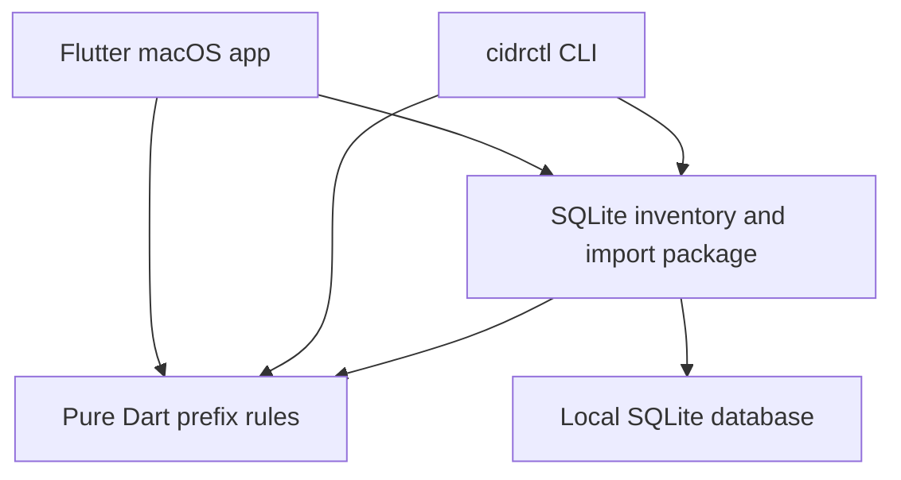

# Architecture

CIDR Atlas starts as a macOS application with local storage. The CLI is a second
client of the same core and persistence packages. Neither client needs a web
server or an OCI connection.

## Package boundaries

| Path | Responsibility |
| --- | --- |
| `packages/cidr_core` | IPv4/IPv6 parsing, immutable records, hierarchy validation, routing-domain conflicts, free-space calculations |
| `packages/cidr_data` | SQLite storage, atomic imports, audit history, CSV/JSON codecs, OCI export normalization |
| `packages/cidr_cli` | Argument parsing, human/structured output, workflow exit codes |
| `apps/cidr_atlas` | Flutter desktop navigation, inventory editing and review, file import/export |

The core has no Flutter dependency. Its calculations apply equally to the macOS
app, a future iOS app, and standalone desktop CLIs. The data package separates
observed OCI inventory from local planning metadata when reconciling imports.

## Address identity and hierarchy

A record represents one CIDR. A VCN with multiple CIDRs produces multiple
records sharing its OCI resource identity. Every prefix has a routing domain;
overlap checking compares active/planned/reserved entries inside the same domain.
Independent clients can reuse ranges in separate domains.

Normal hierarchy is allocation → VCN → subnet. A parent reference is explicit;
arbitrary numeric containment does not establish a valid relationship. Imported
subnets can also establish their relationship through matching VCN resource ID,
tenancy, region, and routing domain. Cycles, missing parents, invalid kind
relationships, and out-of-parent prefixes are structural errors.

IPv4 and IPv6 use the same domain-aware logic. Network arithmetic uses full-width
integers; IPv6 addresses are not reduced to floating-point numbers. Canonical
input is required to prevent accidental expansion or reassignment of a requested
prefix.

## Writes and import behavior

Manual reservations first validate structure and check conflicts. The CLI refuses
conflicting reservations. The store permits structurally valid overlaps because
discovery must be able to preserve real-world conflicts for review.

Import has two stages: parse/preview, then apply. Applying a batch validates the
combined inventory and commits atomically. Updates merge by stable record ID;
matching OCI resource/CIDR identities can reconcile an existing manual record.
The shared store produces the same proposed merged inventory for client previews
and committed imports, including parent-ID remapping. OCI updates preserve local owner, notes, status, parent, environment, and customer
fields. Omitted resources remain present; a partial export cannot establish
deletion or release of address space.

The audit trail records local operations and import provenance. This is an
operational history, not a tamper-evident compliance ledger. The audit timestamp
records when a file was applied; `verifiedAt` records the source observation
time from OCI bundle `metadata.collectedAt`. Unknown observation time remains
unknown rather than becoming the import time. Import coverage and observation
timestamps are evidence about observations, not a guarantee of complete tenancy
discovery.

## Local data and platform rollout

On macOS, both interfaces use Application Support under
`cidr_atlas/inventory.sqlite`. CLI `--db` enables an isolated inventory or test
database. SQLite is local to the app process; no shared-folder synchronization
is implemented. JSON exports provide reviewable backups and manual transfer.

Mac desktop code is the first graphical target. The shared Dart packages prepare
for iOS, Windows, and Linux. Platform menus, navigation, permissions, file pickers,
and release artifacts still require per-platform implementation and verification.
macOS build/signing and iOS builds require Apple tooling on a Mac.

A future team service should coordinate reservations transactionally through an
API. It should keep one allocation authority and explicit access controls rather
than synchronize live SQLite files. Read-only OCI collectors can later publish
inventory bundles or observations without making the iOS app depend on an OCI CLI
installation or desktop-held credentials.
