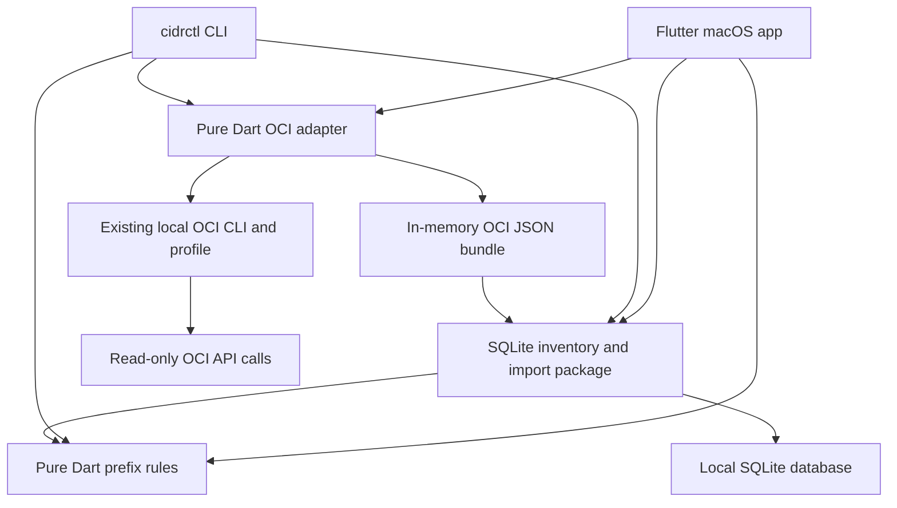

# CIDR Atlas architecture

Author: Sergio Farfan <sergio.farfan@gmail.com>

CIDR Atlas starts as a macOS application with local storage. The CLI is a second
client of the same core and persistence packages. Both clients can explicitly
collect read-only OCI inventory through a shared OCI CLI adapter. Offline
inventory work and CSV/JSON import/export need no OCI connection or web server.

## Package boundaries

| Path | Responsibility |
| --- | --- |
| `packages/cidr_core` | IPv4/IPv6 parsing, immutable records, hierarchy validation, routing-domain conflicts, free-space calculations |
| `packages/cidr_data` | SQLite storage, atomic imports, audit history, CSV/JSON codecs, OCI export normalization |
| `packages/cidr_oci` | Profile metadata, executable resolution, scoped read-only OCI collection, process lifecycle, observation bundles |
| `packages/cidr_cli` | Argument parsing, human/structured output, workflow exit codes |
| `apps/cidr_atlas` | Flutter desktop navigation, inventory editing and review, file import/export |

The core, data, and OCI packages have no Flutter dependency. Core calculations
apply equally to the macOS app and standalone desktop CLIs, and would apply to
any future graphical target. The data package separates observed OCI inventory
from local planning metadata when reconciling imports. The OCI adapter has no database dependency and cannot write
inventory; both clients pass its bundle through the existing data import path.

## Address identity and hierarchy

A record represents one CIDR. A VCN with multiple CIDRs produces multiple
records sharing its OCI resource identity. Every prefix has a routing domain;
overlap checking compares active/planned/reserved entries inside the same domain.
Independent clients can reuse ranges in separate domains.

Normal hierarchy is allocation → VCN → subnet. A parent reference is explicit;
arbitrary numeric containment does not establish a valid relationship. Imported
subnets can also establish their relationship through matching VCN resource ID,
tenancy, region, and routing domain. Cycles, missing parents, invalid kind
relationships, and out-of-parent prefixes are structural errors. A placeholder
VCN parent without a resource id stays valid, as in v0.3.0, even when the
subnet's VCN OCID names a comparable VCN recorded elsewhere (not retired, in the
same routing domain, and in the same tenancy and region where both records set
them). That contradiction is a non-blocking advisory
(`InventoryRules.advisories`): it names the subnet, the recorded VCN by name,
CIDR and OCID, and the placeholder parent, and asks to clear or change the
parent. Import previews list it as a warning, CLI `check`/`reserve` print it on
stderr, and the record editor shows it, so an OCI refresh that brings in the
real VCN still applies.

Conflict detection sorts each routing-domain/IP-version bucket by network
address and sweeps it, checking ancestry only for overlapping pairs; cost is
O(n log n + overlapping pairs) rather than all pairs. `conflictsFor` limits the
same sweep to buckets with changed records for write transactions and editors.

IPv4 and IPv6 use the same domain-aware logic. Network arithmetic uses full-width
integers; IPv6 addresses are not reduced to floating-point numbers. Canonical
input is required to prevent accidental expansion or reassignment of a requested
prefix.

## Writes and import behavior

Manual reservations first validate structure and check conflicts. The CLI refuses
conflicting reservations. The store permits structurally valid overlaps because
discovery must be able to preserve real-world conflicts for review. Deletion is
one transaction for one or several records; a record that a remaining record
names as its parent is refused with the children listed, so a delete never
leaves a dangling parent link. When SQLite has already rolled back a failed
transaction, the original error is reported.

Import has two stages: parse/preview, then apply. Applying a batch validates the
combined inventory and commits atomically. Updates merge by stable record ID;
matching OCI resource/CIDR identities can reconcile an existing manual record.
The shared store produces the same proposed merged inventory for client previews
and committed imports, including parent-ID remapping. OCI updates preserve local owner, notes, status, parent, environment, and customer
fields. Omitted resources remain present; a partial export cannot establish
deletion or release of address space. A CSV row matched by ID updates only the
columns its header supplies, so a narrow spreadsheet cannot erase fields it
does not mention; JSON backup records still replace the whole record. OCI
previews warn, without changing the merge, when a locally retired record is
still observed live, when the bundle is older than an existing observation,
and when raw CLI input is a single truncated page. CSV export guards cells that
spreadsheets would evaluate as formulas and import reverses that guard exactly.

The audit trail records local operations and import provenance. This is an
operational history, not a tamper-evident compliance ledger. The audit timestamp
records when a file was applied; `verifiedAt` records the source observation
time from OCI bundle `metadata.collectedAt`. Unknown observation time remains
unknown rather than becoming the import time. Records write `verifiedAt` in UTC.
CSV and backup input should carry an explicit `Z` or UTC offset and must
carry a valid calendar date. The zone-less form that v0.3.0 wrote in CSV
exports and backups is still accepted and read as local time, with a preview
warning counting such values, so older backups restore; stored zone-less values
are read the same way. Import coverage and observation timestamps are evidence
about observations, not a guarantee of complete tenancy discovery.

## Address planning

The pure Dart core calculates CIDR details, OCI IPv4 capacity, address demand,
disjoint free/blocked intervals, exact aligned slot counts, and bounded
recommendations. Both frontends call `AddressPlanner.plan`; drawing geometry
does not determine availability. IPv6 arithmetic uses `BigInt`, and no address
space is enumerated to calculate totals. A bounded candidate list is distinct
from the exact total number of aligned slots.

The planner and the legacy availability query share blocker and ancestry rules.
Only the selected pool and its valid explicit ancestors are exempt. Unrelated
containment blocks space, retired records do not, and routing domains remain
explicit. Overlapping blockers are unioned before counting; partially occupied
slots cannot be recommended. Recommendations prefer the smallest fitting maximal
free CIDR, then address, with aligned edges before interior alternatives. This
heuristic preserves useful contiguous space without claiming optimal packing.

Demand uses an explicit current/peak count, growth percentage and separate fixed
allowance. Exact ceiling arithmetic chooses the most specific eligible prefix.
OCI IPv4 subnets use `/16..30` with three reserved addresses. Oracle's
[IPv4 and IPv6 comparison](https://docs.oracle.com/en-us/iaas/Content/Network/Concepts/ipv6.htm)
gives the IPv4 subnet size as "/16 to /30, with 3 addresses reserved in each
subnet by Oracle (first 2 and last 1)". The
[Networking Overview](https://docs.oracle.com/en-us/iaas/Content/Network/Concepts/overview.htm)
states the VCN size range of /16 to /30 and identifies the reserved addresses as
the network address, the subnet default gateway and the broadcast address; the
[VCN and subnet overview](https://docs.oracle.com/en-us/iaas/Content/Network/Tasks/Overview_of_VCNs_and_Subnets.htm)
states that the first two addresses and the last in each subnet CIDR are
reserved but defers the size range to the Networking Overview.
Generic prefixes expose raw capacity without assuming provider or link semantics.
Oracle's differing IPv6 reservation descriptions are surfaced as a policy
limitation rather than resolved by guessing. Service-specific demand must be
entered by the operator; capacity alone does not validate service limits.

The Flutter workspace presents inventory hierarchy, grouped OCI VCN identities,
CIDR details, a free/blocked map, exact summaries and bounded alternatives. It
invalidates calculations when inputs or inventory change; a new record list from
the controller counts as an inventory change, so a refresh clears current
results. The hierarchy model is cached per inventory list and reuses the
controller's conflicts instead of rescanning. The reservation editor
permits review of metadata and requires recalculation if network, routing scope,
or hierarchy changes. Save errors stay inside the open editor with the form
input kept. Records observed by OCI keep their observed identity fields
read-only in the editor; refresh from OCI updates them. `InventoryStore.reserve` rejects duplicate IDs, invalid
structure and current conflicts atomically; the planner never offers a conflict
override. Saved notes retain demand, policy, ranking and coverage rationale through
backup/restore and OCI refresh. Existing imports continue to preserve discovered
conflicts for review.

This workspace shows address relationships. Observed route, gateway, DRG,
security-filter and reachability relationships require additional typed resources
and collection; CIDR containment does not establish connectivity. All availability
claims are conditional on the supplied inventory and its coverage.

## Live OCI collection

The desktop app's existing Import dialog offers live discovery alongside offline
CSV/JSON files. It reads profile-selection metadata when discovery opens, then
requires explicit **Load scopes** and **Discover inventory** actions for network
requests. The CLI exposes the same adapter through `discover oci`, requiring
profile and routing domain, plus explicit region and compartment scope modes. It previews by default;
`--apply` performs the shared atomic import. The database path is checked before
any OCI request. A successful nonempty CLI preview can create the selected
SQLite file, with a stderr warning, but changes no inventory or history records;
an empty live discovery exits 0 without opening or creating the database.

The adapter locates an existing OCI CLI through an explicit executable path
(`~/` expanded), PATH, `$HOME/bin/oci` (Oracle's installer default), then the
macOS Homebrew locations. Configuration selection uses an explicit path,
otherwise `OCI_CLI_CONFIG_FILE` when set, otherwise `~/.oci/config`. Because a
Finder-launched app usually lacks shell variables, the app and a shell-launched
CLI can resolve the same profile name from different files; the CLI prints the
configuration file and profile it used. Profile parsing follows Python
ConfigParser, which the OCI SDK uses, including header comments and indented
continuation lines. Only allowlisted selection
metadata is retained, with DEFAULT inheritance and API-key/security-token mode
selection. The adapter does not open private-key or token files; the CLI process
uses its own credentials. Failed or expired credentials require repair or renewal
outside CIDR Atlas. These assumptions follow Oracle's
[configuration/profile format](https://docs.oracle.com/en-us/iaas/Content/API/Concepts/sdkconfig.htm)
and [token authentication lifecycle](https://docs.oracle.com/en-us/iaas/Content/API/SDKDocs/clitoken.htm).

Region selection supports one/several explicit regions or all READY subscribed
regions; compartment selection supports one direct compartment or all accessible
active compartments and subcompartments, including root. Broad modes enumerate
fresh scopes during collection. Compartments are global and enumerated once;
regional VCN/subnet lists traverse the selected region × compartment matrix
sequentially, with all pages and no resource filters. Each resource records its
actual query region, and multi-region metadata omits a misleading scalar region.
Regions are canonicalized before deduplication: input is trimmed and lowercased,
full identifiers are accepted, and three-letter region keys such as `IAD` are
mapped to region names through the tenancy's region subscriptions. Unknown keys
and other shapes are rejected before any resource request, so an alias never
becomes a second inventory scope. The store matches refreshed OCI records by
OCID, kind, CIDR, routing domain and tenancy, not by region spelling, so records
that v0.3.0 stored under `IAD` or an uppercase name are updated in place, keep
their planning fields and take the canonical region. Compartments carry their parent OCID and a
display path from the tenancy root (`root / prod / network`), which tells
same-named compartments apart; the list starts with the tenancy root and is
otherwise sorted by path.
Manual comma-separated regions and a compartment OCID remain available for narrow
scopes. READY filtering and root-only subtree enumeration follow Oracle's
[region subscription](https://docs.oracle.com/en-us/iaas/tools/oci-cli/latest/oci_cli_docs/cmdref/iam/region-subscription/list.html)
and [compartment](https://docs.oracle.com/en-us/iaas/tools/oci-cli/latest/oci_cli_docs/cmdref/iam/compartment/list.html)
references. ACCESSIBLE reflects INSPECT visibility, which cannot establish network
read permission or visibility of all tenancy compartments. Required failures stop
the entire run; no partial bundle is applicable. Single-compartment mode remains
direct only. Oracle's [VCN list](https://docs.oracle.com/en-us/iaas/tools/oci-cli/latest/oci_cli_docs/cmdref/network/vcn/list.html)
and [subnet list](https://docs.oracle.com/en-us/iaas/tools/oci-cli/latest/oci_cli_docs/cmdref/network/subnet/list.html)
define the regional resource calls.

A subnet can reference a VCN absent from the selected-compartment list. The
collector first completes all regional lists, deduplicates references per region/ID and performs individual
[VCN gets](https://docs.oracle.com/en-us/iaas/tools/oci-cli/latest/oci_cli_docs/cmdref/network/vcn/get.html)
for context; it does not enumerate their other subnets. Context from another
compartment is identified in coverage. A denied/not-found context lookup is a
warning, preserving the subnet's VCN ID without fabricating a parent. Required
list failures, malformed successful responses, cancellation, or timeout return
no applicable partial bundle. Local records remain untouched.

OCI CLI 3.94.1 suppresses output for an empty list. A successful blank response
is normalized only for the four known list operations; object lookups still
require a valid object. An empty result produces guidance for the requested scope without implying
that a CIDR must be entered or an already-included child separately imported. Genuine response-shape errors identify the operation and expected field
or type without raw resource values. The behavior follows Oracle's
[CLI renderer](https://github.com/oracle/oci-cli/blob/v3.94.1/src/oci_cli/cli_util.py#L893-L947).

Each process receives an executable and argument array without a shell. Explicit
configuration, profile, authentication, region, and JSON output plus an empty rc
file prevent local defaults from changing the intended scope. Inherited OCI
overrides are removed from the child except `OCI_CLI_CERT_BUNDLE`; normal OS,
proxy, and TLS trust settings remain. `OCI_CLI_CONFIG_FILE` is also removed from
the child, but the adapter reads it once to choose the configuration file it
then passes explicitly. Oracle documents these sources of defaults in
[CLI option precedence](https://docs.oracle.com/en-us/iaas/Content/API/SDKDocs/clienvironmentvariables.htm)
and [CLI rc configuration](https://docs.oracle.com/en-us/iaas/Content/API/SDKDocs/cliconfigure.htm).
The child receives closed stdin, both output streams are consumed, and no raw
credential-bearing diagnostics are presented. Every command passes
`--connection-timeout 10`, `--read-timeout 15` and `--max-retries 3`. In the
installed OCI CLI 3.94.1, `--max-retries` sets the SDK's total attempt count, so
3 is one try plus two retries; there is no second retry loop in Dart. Each
command is bounded to 120 seconds, which covers three attempts plus SDK backoff;
`--all` pagination can make several HTTP requests in one command, each with its
own retries, so a long paginated listing can reach the bound and fail closed. The whole-collection limit applies
on top of the command bound: 180 seconds for one region/compartment pair or 1800
seconds for broader modes, or an explicit limit from CLI `--collection-timeout`
(30 to 86,400 seconds) or the dialog's optional limit (1 to 1440 minutes). With
worst-case retries, the 180-second limit can end a single-pair collection before
its second command's own bound; collection then fails closed. The limit is
recomputed after region keys resolve, measured from the start of collection.
Termination and stream cleanup are bounded. Dialog dismissal and CLI Ctrl-C
cancel active collection and reject late results. Progress events carry the
scope count and the limit in effect, so the CLI states both before the first
scope.

The returned bundle records tenancy, actual regions/compartments and selection
modes, completed pairs/resource counts, UTC collection start/completion, all-page
collection, and regional context outcomes. It describes
an observation interval rather than a transactionally consistent snapshot or a
complete tenancy audit. CIDR normalization and hierarchy validation remain in
`cidr_data`/`cidr_core`. The JSON preview keeps its `OCI JSON` source identity and
record source `oci`, preserving existing reconciliation safeguards. Every
distinct IPv4/IPv6 prefix remains a separate record, including subnet IPv4 arrays
and VCN BYOIPv6 arrays.

## Local data and platform rollout

Both interfaces open the path from the shared `cidr_data` function
`defaultDatabasePath`. On macOS that is
`~/Library/Application Support/cidr_atlas/inventory.sqlite`, not a
bundle-specific folder; sharing it requires the app to remain unsandboxed. The
path is unchanged from v0.3.0. Windows uses `%APPDATA%/cidr_atlas/inventory.sqlite`; other systems
use `$XDG_DATA_HOME/cidr_atlas/inventory.sqlite` when it is absolute, otherwise
`~/.local/share/cidr_atlas/inventory.sqlite`. CLI `--db` enables an isolated
inventory or test database, and the CLI warns on stderr whenever a command
creates a new empty database file. SQLite is local to the app process; no shared-folder synchronization
is implemented. JSON exports provide reviewable backups and manual transfer.
New installations start empty. Optional fictional sample records carry source
`demo`, are only added to an empty database, and can be removed together in one
transaction.

Mac desktop code is the only graphical target. The shared Dart packages keep
Windows and Linux reachable; iOS was dropped on 2026-10-17 and the project has no
iOS platform directory. Platform menus, navigation, permissions, file pickers,
and release artifacts still require per-platform implementation and verification.
macOS build and signing require Apple tooling on a Mac.

A future team service should coordinate reservations transactionally through an
API. It should keep one allocation authority and explicit access controls rather
than synchronize live SQLite files. Read-only desktop collectors can publish
inventory bundles or observations to a future service without making every client
depend on an OCI CLI installation or desktop-held credentials.

## macOS artifacts

`scripts/build_macos.sh` builds the Flutter macOS app. `scripts/build_cli.sh`
compiles the standalone CLI for its current operating system. The DMG procedure
in `scripts/build_dmg.sh` requires macOS and packages the universal app with an
Applications shortcut, installation instructions, and third-party notices. It
checks both architectures and signature integrity, verifies and mounts the image,
checks its contents, then writes and validates a SHA-256 checksum. Artifacts are
generated under ignored `build/releases/` and published separately through the
repository's [GitHub Releases](https://github.com/sergio-farfan/cidr-atlas/releases/tag/v0.3.0).

The preview app uses an ad hoc signature. DMG integrity and local code-signature
verification do not establish Developer ID signing, notarization, or Gatekeeper
acceptance on another Mac. Signing and notarization remain separate distribution
work. Disk-image behavior follows Apple's
[Disk Utility documentation](https://support.apple.com/guide/disk-utility/create-a-disk-image-dskutl11888/mac)
and the installed Apple command help.
