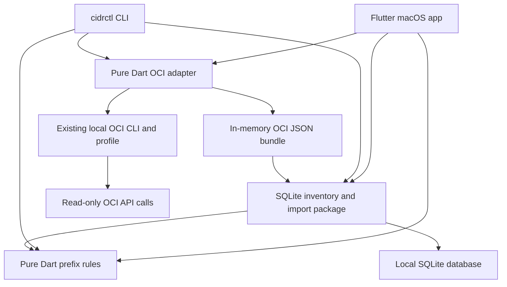

# CIDR Atlas architecture

Author: Sergio Farfan <sergio.farfan@gmail.com>

CIDR Atlas starts as a macOS application with local storage. The CLI is a second
client of the same core and persistence packages. Both clients can explicitly
collect read-only OCI inventory through a shared OCI CLI adapter. Offline
inventory work and CSV/JSON import/export need no OCI connection or web server.

## Package boundaries

| Path | Responsibility |
| --- | --- |
| `packages/cidr_core` | IPv4/IPv6 parsing, immutable records, hierarchy validation, routing-domain conflicts, free-space calculations |
| `packages/cidr_data` | SQLite storage, atomic imports, audit history, CSV/JSON codecs, OCI export normalization |
| `packages/cidr_oci` | Profile metadata, executable resolution, scoped read-only OCI collection, process lifecycle, observation bundles |
| `packages/cidr_cli` | Argument parsing, human/structured output, workflow exit codes |
| `apps/cidr_atlas` | Flutter desktop navigation, inventory editing and review, file import/export |

The core, data, and OCI packages have no Flutter dependency. Core calculations
apply equally to the macOS app, a future iOS app, and standalone desktop CLIs. The
data package separates observed OCI inventory from local planning metadata when
reconciling imports. The OCI adapter has no database dependency and cannot write
inventory; both clients pass its bundle through the existing data import path.

## Address identity and hierarchy

A record represents one CIDR. A VCN with multiple CIDRs produces multiple
records sharing its OCI resource identity. Every prefix has a routing domain;
overlap checking compares active/planned/reserved entries inside the same domain.
Independent clients can reuse ranges in separate domains.

Normal hierarchy is allocation → VCN → subnet. A parent reference is explicit;
arbitrary numeric containment does not establish a valid relationship. Imported
subnets can also establish their relationship through matching VCN resource ID,
tenancy, region, and routing domain. Cycles, missing parents, invalid kind
relationships, and out-of-parent prefixes are structural errors.

IPv4 and IPv6 use the same domain-aware logic. Network arithmetic uses full-width
integers; IPv6 addresses are not reduced to floating-point numbers. Canonical
input is required to prevent accidental expansion or reassignment of a requested
prefix.

## Writes and import behavior

Manual reservations first validate structure and check conflicts. The CLI refuses
conflicting reservations. The store permits structurally valid overlaps because
discovery must be able to preserve real-world conflicts for review.

Import has two stages: parse/preview, then apply. Applying a batch validates the
combined inventory and commits atomically. Updates merge by stable record ID;
matching OCI resource/CIDR identities can reconcile an existing manual record.
The shared store produces the same proposed merged inventory for client previews
and committed imports, including parent-ID remapping. OCI updates preserve local owner, notes, status, parent, environment, and customer
fields. Omitted resources remain present; a partial export cannot establish
deletion or release of address space.

The audit trail records local operations and import provenance. This is an
operational history, not a tamper-evident compliance ledger. The audit timestamp
records when a file was applied; `verifiedAt` records the source observation
time from OCI bundle `metadata.collectedAt`. Unknown observation time remains
unknown rather than becoming the import time. Import coverage and observation
timestamps are evidence about observations, not a guarantee of complete tenancy
discovery.

## Live OCI collection

The desktop app's existing Import dialog offers live discovery alongside offline
CSV/JSON files. It reads profile-selection metadata when discovery opens, then
requires explicit **Load scopes** and **Discover inventory** actions for network
requests. The CLI exposes the same adapter through `discover oci`, requiring
profile, region, compartment, and routing domain flags. It previews by default;
`--apply` performs the shared atomic import. A successful CLI preview can create
the selected SQLite file but changes no inventory or history records.

The adapter locates an existing OCI CLI through PATH, standard macOS Homebrew
locations, or an explicit executable path. Configuration selection supports an
explicit path and the standard local profile file. Only allowlisted selection
metadata is retained, with DEFAULT inheritance and API-key/security-token mode
selection. The adapter does not open private-key or token files; the CLI process
uses its own credentials. Failed or expired credentials require repair or renewal
outside CIDR Atlas. These assumptions follow Oracle's
[configuration/profile format](https://docs.oracle.com/en-us/iaas/Content/API/Concepts/sdkconfig.htm)
and [token authentication lifecycle](https://docs.oracle.com/en-us/iaas/Content/API/SDKDocs/clitoken.htm).

Region and compartment enumeration returns subscribed regions and accessible
active compartments plus a tenancy-root entry. The UI enables READY regions and
offers manual scope entry when IAM prevents enumeration. Enumerating a
compartment subtree populates a selector; resource collection still lists only
VCNs and subnets directly in one explicitly selected compartment and region.
Selecting a parent or root does not collect descendant resources. Both resource
lists fetch all pages without display-name, VCN, or lifecycle filters, using
Oracle's [VCN list](https://docs.oracle.com/en-us/iaas/tools/oci-cli/latest/oci_cli_docs/cmdref/network/vcn/list.html)
and [subnet list](https://docs.oracle.com/en-us/iaas/tools/oci-cli/latest/oci_cli_docs/cmdref/network/subnet/list.html)
contracts.

A subnet can reference a VCN absent from the selected-compartment list. The
collector deduplicates those references and performs individual
[VCN gets](https://docs.oracle.com/en-us/iaas/tools/oci-cli/latest/oci_cli_docs/cmdref/network/vcn/get.html)
for context; it does not enumerate their other subnets. Context from another
compartment is identified in coverage. A denied/not-found context lookup is a
warning, preserving the subnet's VCN ID without fabricating a parent. Required
list failures, malformed successful responses, cancellation, or timeout return
no applicable partial bundle. Local records remain untouched.

Each process receives an executable and argument array without a shell. Explicit
configuration, profile, authentication, region, and JSON output plus an empty rc
file prevent local defaults from changing the intended scope. Inherited OCI
overrides are removed except `OCI_CLI_CERT_BUNDLE`; normal OS, proxy, and TLS trust
settings remain. Oracle documents these sources of defaults in
[CLI option precedence](https://docs.oracle.com/en-us/iaas/Content/API/SDKDocs/clienvironmentvariables.htm)
and [CLI rc configuration](https://docs.oracle.com/en-us/iaas/Content/API/SDKDocs/cliconfigure.htm).
The child receives closed stdin, both output streams are consumed, OCI retries
are bounded, and no raw credential-bearing diagnostics are presented. Requests
have a 60-second deadline and the complete collection has a 180-second deadline,
followed by bounded termination and stream cleanup. Dialog dismissal and CLI
Ctrl-C cancel active collection and reject late results.

The returned bundle records tenancy, region, UTC collection start/completion,
the selected compartment, all-page collection, and context outcomes. It describes
an observation interval rather than a transactionally consistent snapshot or a
complete tenancy audit. CIDR normalization and hierarchy validation remain in
`cidr_data`/`cidr_core`. The JSON preview keeps its `OCI JSON` source identity and
record source `oci`, preserving existing reconciliation safeguards. Every
distinct IPv4/IPv6 prefix remains a separate record, including subnet IPv4 arrays
and VCN BYOIPv6 arrays.

## Local data and platform rollout

On macOS, both interfaces use Application Support under
`cidr_atlas/inventory.sqlite`. CLI `--db` enables an isolated inventory or test
database. SQLite is local to the app process; no shared-folder synchronization
is implemented. JSON exports provide reviewable backups and manual transfer.

Mac desktop code is the first graphical target. The shared Dart packages prepare
for iOS, Windows, and Linux. Platform menus, navigation, permissions, file pickers,
and release artifacts still require per-platform implementation and verification.
macOS build/signing and iOS builds require Apple tooling on a Mac.

A future team service should coordinate reservations transactionally through an
API. It should keep one allocation authority and explicit access controls rather
than synchronize live SQLite files. Read-only desktop collectors can publish
inventory bundles or observations to a future service without making the iOS app
depend on an OCI CLI installation or desktop-held credentials.

## macOS artifacts

`scripts/build_macos.sh` builds the Flutter macOS app. `scripts/build_cli.sh`
compiles the standalone CLI for its current operating system. The DMG procedure
in `scripts/build_dmg.sh` requires macOS and packages the universal app with an
Applications shortcut, installation instructions, and third-party notices. It
checks both architectures and signature integrity, verifies and mounts the image,
checks its contents, then writes and validates a SHA-256 checksum. Artifacts are
generated under ignored `build/releases/` and published separately through the
private repository's [GitHub Releases](https://github.com/sergio-farfan/cidr-atlas/releases/tag/v0.1.0).

The initial app uses an ad hoc signature. DMG integrity and local code-signature
verification do not establish Developer ID signing, notarization, or Gatekeeper
acceptance on another Mac. Signing and notarization remain separate distribution
work. Disk-image behavior follows Apple's
[Disk Utility documentation](https://support.apple.com/guide/disk-utility/create-a-disk-image-dskutl11888/mac)
and the installed Apple command help.
